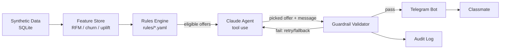

# OfferPilot

An agentic, guardrailed personalised offer engine — built for Hackathon 2
(Punjab Jobs AI Bootcamp, J-PAL South Asia). All data is synthetic.

**Status: Phase 1 done.** 5,000 synthetic customers with 12 months of
simulated behaviour (843k events) feed a deterministic rules engine that
sends real, personalised Telegram messages. The AI agent, uplift modelling,
and the marketing dashboard land in later phases (see Roadmap below).

## Setup (5 steps)

1. **Clone and create a virtual environment**
   ```bash
   python -m venv .venv
   .venv/Scripts/activate        # Windows
   pip install -r requirements.txt
   pip install -e .
   ```
2. **Install the git hooks** (blocks commits containing secrets)
   ```bash
   python scripts/install_hooks.py
   ```
3. **Get your credentials**
   - Telegram bot token: message [@BotFather](https://t.me/BotFather) on Telegram,
     send `/newbot`, follow the prompts, copy the token it gives you.
   - Anthropic API key: create one at [console.anthropic.com](https://console.anthropic.com/settings/keys).
   - Copy `.env.example` to `.env` and paste both values in. `.env` is gitignored —
     never commit it.
4. **Generate synthetic data** (5,000 customers, 12 months of behaviour — takes ~1-2 min)
   ```bash
   python -m offerpilot.data_gen.generate_customers --n 5000
   python -m offerpilot.data_gen.generate_events
   python -m offerpilot.data_gen.data_validation   # charts + stats in data/validation/
   ```
5. **Run the bot**
   ```bash
   python -m offerpilot.bot.main
   ```
   Message your bot `/start` on Telegram — it assigns you a synthetic customer
   profile and sends back the one offer the rules engine picked for them.
   (Regenerating data resets every classmate's binding — they just re-run `/start`.)

## Running tests

```bash
pytest
```

## Data realism

[`data_validation.py`](src/offerpilot/data_gen/data_validation.py) checks the
generated data against the patterns a real platform would show, and prints
the headline numbers (charts land in `data/validation/`, gitignored — rerun
to regenerate). Latest run, 5,000 customers / 843k events:

| Pattern | Target | Observed |
|---|---|---|
| Pareto spend concentration | top 20% of customers ≈ 70-80% of revenue | **79.6%** |
| COD share by city tier | tier-3 > tier-2 > metro | metro 19.7% < tier-2 37.8% < tier-3 58.4% ✅ |
| Return rate by category | Fashion highest | Fashion 39.1%, Footwear 28.5%, Jewellery 23.3% ✅ |
| Weekly cycle | weekend bump | Sat/Fri/Sun highest, Monday lowest ✅ |
| Festival spikes | visible around Diwali / Big-Billion-style sale / Baisakhi / Lohri | visible in `seasonality_daily.png` ✅ |

A small, git-committed sample lives in
[`data/raw/sample_customers.csv`](data/raw/sample_customers.csv) and
[`data/raw/sample_events.csv`](data/raw/sample_events.csv) (15 customers, ~2.3k
events) so you can browse the shape of the data without running the generator.

Each customer also carries a **hidden** `persona` (8 types, e.g. Loyal
Champion, At-Risk, Coupon Abuser) and `latent_uplift_label` (persuadable /
sure-thing / lost-cause / do-not-disturb) in
[`personas.py`](src/offerpilot/data_gen/personas.py) — these drive the
simulation but no rule, model, or agent is allowed to read them. They exist
only so Phase 6 can score how well the (blind) decision engine performed.

## Editing the rules

All business rules live in [`rules/*.yaml`](rules/), in plain English with
comments — no code changes needed to adjust them:
- [`rules/offer_catalogue.yaml`](rules/offer_catalogue.yaml) — the menu of offers.
- [`rules/limits.yaml`](rules/limits.yaml) — hard caps (max discount, consent,
  quiet hours, etc.) that every offer, AI-picked or not, must pass.

## Architecture



Today's thin slice is `A -> C -> F` directly, with a simple deterministic
picker standing in for the agent box until Phase 4.

## Roadmap

| Phase | What | Status |
|---|---|---|
| 0 | Thin end-to-end slice (data → rules → bot) | ✅ done |
| 1 | Full synthetic data generator + realism validation | ✅ done |
| 2 | RFM, churn model, uplift (T-learner) model | planned |
| 3 | Full rules engine, conflict checker, versioning | planned |
| 4 | Claude tool-use agent + guardrail validator | planned |
| 5 | Full Telegram bot (cards, /why, /simulate, negotiation, i18n) | planned |
| 6 | Holdout measurement, basic offline evaluation | stretch |
| 7 | Streamlit dashboard | stretch (minimal version) |
| 8 | Advanced triggers, send-time optimisation, win-back journeys | cut — future work |

## Project layout

See [`src/offerpilot/`](src/offerpilot/) for the package (data generation,
feature store, rules engine, agent, bot) and [`tests/`](tests/) for pytest
coverage of the rules engine and guardrails.
