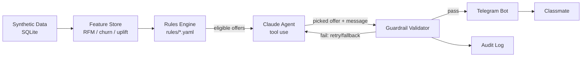

# OfferPilot

An agentic, guardrailed personalised offer engine — built for Hackathon 2
(Punjab Jobs AI Bootcamp, J-PAL South Asia). All data is synthetic.

**Status: Day 1 thin slice.** Synthetic customers → a deterministic rules
engine → one Telegram message. The AI agent, uplift modelling, and the
marketing dashboard land in later phases (see Roadmap below).

## Setup (5 steps)

1. **Clone and create a virtual environment**
   ```bash
   python -m venv .venv
   .venv/Scripts/activate        # Windows
   pip install -r requirements.txt
   pip install -e .
   ```
2. **Install the git hooks** (blocks commits containing secrets)
   ```bash
   python scripts/install_hooks.py
   ```
3. **Get your credentials**
   - Telegram bot token: message [@BotFather](https://t.me/BotFather) on Telegram,
     send `/newbot`, follow the prompts, copy the token it gives you.
   - Anthropic API key: create one at [console.anthropic.com](https://console.anthropic.com/settings/keys).
   - Copy `.env.example` to `.env` and paste both values in. `.env` is gitignored —
     never commit it.
4. **Generate synthetic data**
   ```bash
   python -m offerpilot.data_gen.generate_customers --n 50
   ```
5. **Run the bot**
   ```bash
   python -m offerpilot.bot.main
   ```
   Message your bot `/start` on Telegram — it assigns you a synthetic customer
   profile and sends back the one offer the rules engine picked for them.

## Running tests

```bash
pytest
```

## Editing the rules

All business rules live in [`rules/*.yaml`](rules/), in plain English with
comments — no code changes needed to adjust them:
- [`rules/offer_catalogue.yaml`](rules/offer_catalogue.yaml) — the menu of offers.
- [`rules/limits.yaml`](rules/limits.yaml) — hard caps (max discount, consent,
  quiet hours, etc.) that every offer, AI-picked or not, must pass.

## Architecture



Today's thin slice is `A -> C -> F` directly, with a simple deterministic
picker standing in for the agent box until Phase 4.

## Roadmap

| Phase | What | Status |
|---|---|---|
| 0 | Thin end-to-end slice (data → rules → bot) | ✅ in progress |
| 1 | Full synthetic data generator + realism validation | planned |
| 2 | RFM, churn model, uplift (T-learner) model | planned |
| 3 | Full rules engine, conflict checker, versioning | planned |
| 4 | Claude tool-use agent + guardrail validator | planned |
| 5 | Full Telegram bot (cards, /why, /simulate, negotiation, i18n) | planned |
| 6 | Holdout measurement, basic offline evaluation | stretch |
| 7 | Streamlit dashboard | stretch (minimal version) |
| 8 | Advanced triggers, send-time optimisation, win-back journeys | cut — future work |

## Project layout

See [`src/offerpilot/`](src/offerpilot/) for the package (data generation,
feature store, rules engine, agent, bot) and [`tests/`](tests/) for pytest
coverage of the rules engine and guardrails.
