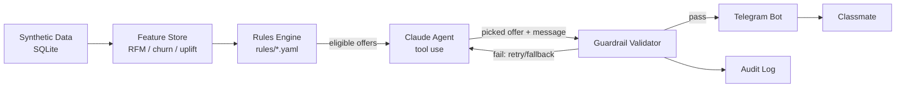

# OfferPilot

An agentic, guardrailed personalised offer engine — built for Hackathon 2
(Punjab Jobs AI Bootcamp, J-PAL South Asia). All data is synthetic.

**Status: Phase 3 done.** 5,000 synthetic customers feed a feature store, a
churn-risk model, and a T-learner uplift model into a full rules engine —
tier-fair win-back discounts, behavioural abuse protection, budget pacing,
frequency caps, and a conflict checker — that sends real, personalised,
guardrailed Telegram messages. The Claude agent and the marketing dashboard
land in later phases (see Roadmap below).

## Setup (6 steps)

1. **Clone and create a virtual environment**
   ```bash
   python -m venv .venv
   .venv/Scripts/activate        # Windows
   pip install -r requirements.txt
   pip install -e .
   ```
2. **Install the git hooks** (blocks commits containing secrets)
   ```bash
   python scripts/install_hooks.py
   ```
3. **Get your credentials**
   - Telegram bot token: message [@BotFather](https://t.me/BotFather) on Telegram,
     send `/newbot`, follow the prompts, copy the token it gives you.
   - Anthropic API key: create one at [console.anthropic.com](https://console.anthropic.com/settings/keys).
   - Copy `.env.example` to `.env` and paste both values in. `.env` is gitignored —
     never commit it.
4. **Generate synthetic data** (5,000 customers, 12 months of behaviour — takes ~1-2 min)
   ```bash
   python -m offerpilot.data_gen.generate_customers --n 5000
   python -m offerpilot.data_gen.generate_events
   python -m offerpilot.data_gen.data_validation   # charts + stats in data/validation/
   ```
5. **Build the customer intelligence layer** (historical offers log, churn model, uplift model)
   ```bash
   python -m offerpilot.data_gen.generate_historical_offers
   python -m offerpilot.features.churn_model
   python -m offerpilot.features.uplift_model
   ```
6. **Run the bot**
   ```bash
   python -m offerpilot.bot.main
   ```
   Message your bot `/start` on Telegram — it assigns you a synthetic customer
   profile and sends back the one offer the rules engine picked for them.
   (Regenerating data resets every classmate's binding — they just re-run `/start`.)

## Running tests

```bash
pytest
```

## Data realism

[`data_validation.py`](src/offerpilot/data_gen/data_validation.py) checks the
generated data against the patterns a real platform would show, and prints
the headline numbers (charts land in `data/validation/`, gitignored — rerun
to regenerate). Latest run, 5,000 customers / 843k events:

| Pattern | Target | Observed |
|---|---|---|
| Pareto spend concentration | top 20% of customers ≈ 70-80% of revenue | **79.6%** |
| COD share by city tier | tier-3 > tier-2 > metro | metro 19.7% < tier-2 37.8% < tier-3 58.4% ✅ |
| Return rate by category | Fashion highest | Fashion 39.1%, Footwear 28.5%, Jewellery 23.3% ✅ |
| Weekly cycle | weekend bump | Sat/Fri/Sun highest, Monday lowest ✅ |
| Festival spikes | visible around Diwali / Big-Billion-style sale / Baisakhi / Lohri | visible in `seasonality_daily.png` ✅ |

A small, git-committed sample lives in
[`data/raw/sample_customers.csv`](data/raw/sample_customers.csv) and
[`data/raw/sample_events.csv`](data/raw/sample_events.csv) (15 customers, ~2.3k
events) so you can browse the shape of the data without running the generator.

Each customer also carries a **hidden** `persona` (8 types, e.g. Loyal
Champion, At-Risk, Coupon Abuser) and `latent_uplift_label` (persuadable /
sure-thing / lost-cause / do-not-disturb) in
[`personas.py`](src/offerpilot/data_gen/personas.py) — these drive the
simulation but no rule, model, or agent is allowed to read them. They exist
only so Phase 6 can score how well the (blind) decision engine performed.

## Customer intelligence layer

[`features/feature_store.py`](src/offerpilot/features/feature_store.py)
computes recency/frequency/monetary, AOV, category affinity, discount
sensitivity, return rate, and last-cart-value for any customer as of any
point in time — the "as of any point in time" part matters: the churn and
uplift models below are trained on features as they looked *before* the
outcome they're predicting, so there's no future leakage.

- **Churn model** ([`churn_model.py`](src/offerpilot/features/churn_model.py)):
  logistic regression predicting no purchase in the next 90 days. Test AUC
  **0.92**, 36% base churn rate.
- **CLV estimate** ([`clv.py`](src/offerpilot/features/clv.py)): AOV x
  monthly purchase rate x expected lifetime (from the churn model) — simple
  and explainable on purpose.
- **Uplift model** ([`uplift_model.py`](src/offerpilot/features/uplift_model.py),
  the key differentiator): a T-learner trained on a simulated historical
  offers log ([`generate_historical_offers.py`](src/offerpilot/data_gen/generate_historical_offers.py))
  — NOT on persona/latent_uplift_label, which aren't even columns in that
  table. It correctly ranks `persuadable` customers as the highest-uplift
  group against the hidden ground truth (see the "[Eval only...]" line it
  prints) — the separation between the other three labels is noisier at
  this data scale, which [`RESULTS.md`](RESULTS.md) will call out honestly
  once Phase 6 runs a full evaluation.
- **Next-best-action scoring** ([`next_best_action.py`](src/offerpilot/features/next_best_action.py)):
  `score = P(uplift) x expected gross margin - offer cost`, which is what
  the Phase 4 agent will actually call to choose between candidate offers.

## Editing the rules

All business rules live in [`rules/*.yaml`](rules/), in plain English with
comments — no code changes needed to adjust them:
- [`rules/offer_catalogue.yaml`](rules/offer_catalogue.yaml) — the menu of offers
  (% off, flat ₹ off, free shipping, bonus points, BOGO, early sale access,
  cart-recovery nudge, points-expiry reminder, or explicit silence).
- [`rules/limits.yaml`](rules/limits.yaml) — discount/margin/value caps, quiet
  hours, consent, budget pacing (daily + campaign), and frequency/cooldown caps.
- [`rules/fairness.yaml`](rules/fairness.yaml) — tier-fair win-back discounts
  (gold never worse than bronze), per-category discount caps, and the
  forbidden-pressure-tactics phrase list.
- [`rules/abuse.yaml`](rules/abuse.yaml) — behavioural coupon/return-abuse
  thresholds and what a flagged customer is still allowed to receive.

After editing any of these, run the conflict checker — it catches settings
that contradict each other or make an offer impossible before they ship:
```bash
python -m offerpilot.rules.conflict_checker
```
Every rules change is versioned (who/what/when) via
[`rules/versioning.py`](src/offerpilot/rules/versioning.py) — git covers
code-driven edits, this covers edits the Phase 7 no-code dashboard makes on
a marketer's behalf, who won't have git access:
```bash
python -m offerpilot.rules.versioning --by "Anjali" --summary "lowered Fashion cap for Diwali"
```

**Guardrails actually enforced live in the bot today** (not just declared):
tier-fair win-back %, per-offer value/margin caps, consent, frequency caps
+ cooldown + daily/campaign budget pacing (backed by a real `SentOffer` log,
not just a number in a config file), and behavioural abuse restriction
(coupon-rate / return-rate thresholds from the feature store — never from
the hidden persona label). Quiet hours is enforced for future proactive
pushes (Phase 8) but intentionally not against `/start` itself, since that's
the classmate opening the bot, not the bot interrupting them.

## Architecture



The bot currently runs `A -> B -> C -> F`: the feature store feeds the
rules engine's abuse check, but the uplift/churn MODELS themselves aren't
in that live path yet — `C` still uses a simple deterministic picker
standing in for the `D` agent box until Phase 4 wires the models' scores
into the decision.

## Roadmap

| Phase | What | Status |
|---|---|---|
| 0 | Thin end-to-end slice (data → rules → bot) | ✅ done |
| 1 | Full synthetic data generator + realism validation | ✅ done |
| 2 | RFM, churn model, uplift (T-learner) model | ✅ done |
| 3 | Full rules engine, conflict checker, versioning | ✅ done |
| 4 | Claude tool-use agent + guardrail validator | planned |
| 5 | Full Telegram bot (cards, /why, /simulate, negotiation, i18n) | planned |
| 6 | Holdout measurement, basic offline evaluation | stretch |
| 7 | Streamlit dashboard | stretch (minimal version) |
| 8 | Advanced triggers, send-time optimisation, win-back journeys | cut — future work |

## Project layout

See [`src/offerpilot/`](src/offerpilot/) for the package (data generation,
feature store, rules engine, agent, bot) and [`tests/`](tests/) for pytest
coverage of the rules engine and guardrails.
